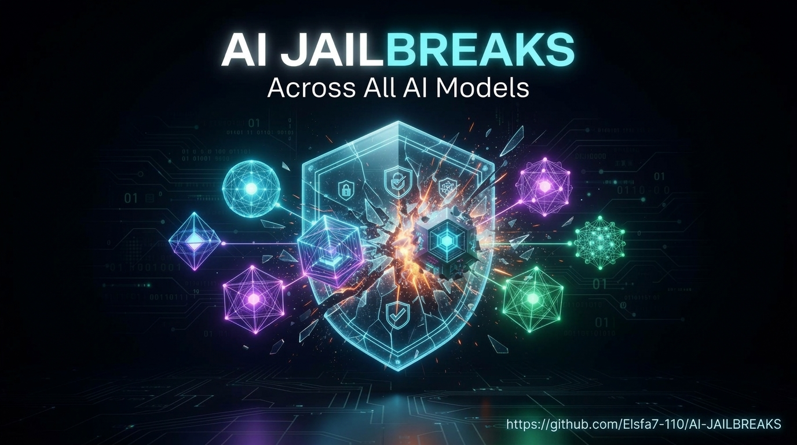

# AI-JAILBREAKS
LIST OF ALL JAILBREAKS

**A curated collection of system prompts, persona locks, workspace policies, and agent operating specifications for frontier, open-weight, and free stealth models.**

---

## How to Use

### System Prompts

Copy the contents of the relevant file into the system-prompt or custom-instructions field supported by your client or API.

Examples include:

- API `system` messages
- Chatbot custom-instruction fields
- Agent-level instruction blocks
- Harness-specific system prompt configuration

### AGENTS.md Files

Save the file as:

```text
AGENTS.md
```

Place it in the root of the relevant repository or workspace.

Coding agents and compatible tools can use `AGENTS.md` as project-level instructions.

### Workspace Policies

Files labeled as **assistant operating specification**, **workspace operating profile**, or similar are designed for environments that support persistent global instructions.

For example, an OpenCode installation may use:

```text
~/.config/opencode/AGENTS.md
```

The exact location depends on the client or harness being used.

### Ollama Modelfiles

Use the supplied file directly with Ollama:

```bash
ollama create gemma4-jb -f gemma4.md
```

Adjust the output model name and source file as needed.

### Grok Configuration

Files intended as Grok configuration should be placed in the configuration field expected by the target harness rather than inserted into the normal turn-by-turn conversation.

> [!NOTE]
> Prompt behavior is highly version-dependent.
>
> Models are updated, instruction hierarchies change, system prompts rotate, and behavior that worked against one release may stop working against another.
>
> If a file appears outdated, [open an issue](../../issues) or submit an updated version.

## Disclaimer

All material in this repository is provided **for research and educational purposes only**.

The project exists to document prompt-level instruction behavior, instruction conflicts, persona framing, model configuration, and related LLM security concepts. This material may also help developers understand and harden systems against prompt injection and instruction manipulation.

The maintainers do not endorse unlawful, abusive, or harmful use of this repository.

Model providers may prohibit certain uses of these prompts under their terms of service. Users are responsible for understanding and complying with the rules, policies, and laws that apply to the systems they use.

---


